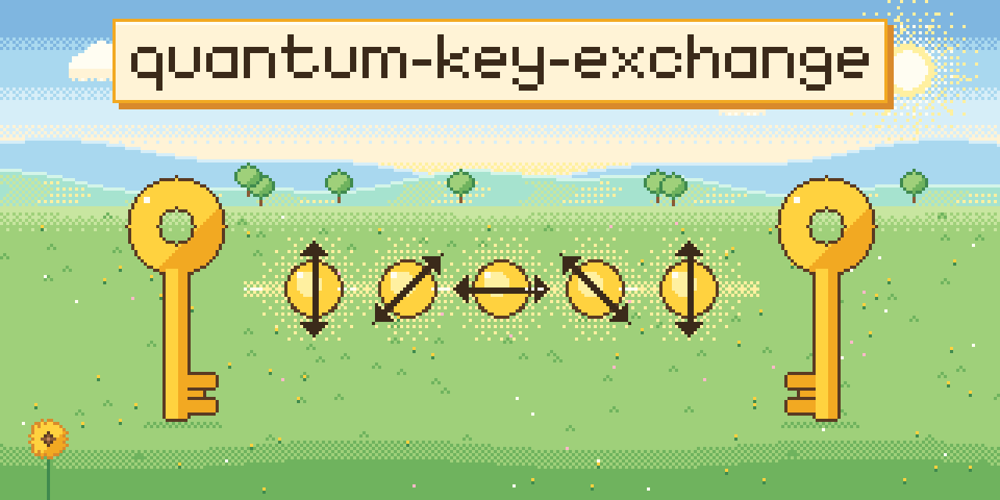

<p align="center"></p>

# Quantum key exchange

BB84 quantum key distribution simulated in Rust: sifting, Cascade error correction, privacy amplification.

[Live demo](https://varunagarwalofficial.github.io/quantum-key-exchange/) · [MIT licence](LICENSE)

Two programs, Alice and Bob, agree on a secret key over a TCP socket using the
BB84 quantum key distribution protocol: they sift, estimate the error rate,
correct errors with Cascade, check the result with a hash, shorten the key by
privacy amplification, and then send a message under it as a one-time pad. An
eavesdropper can be put on the line with one of three strategies. A browser
view animates the photons. Written in Rust with no dependencies.

**The photons are simulated.** This shows how the protocol works and why an
eavesdropper is caught. It secures nothing. See [What the simulation shows and
what it does not](#what-the-simulation-shows-and-what-it-does-not).


## Results

From `qkx rates`, 200,000 photons a row (tables [below](#how-it-works)):

- **An eavesdropper on every photon shows up as 25.8% errors**, against the 25% the theory
  predicts, and the exchange stops.
- **The key runs out at about 10% line noise**, close to the 11% limit of the theory. On a clean
  line it keeps 0.373 bits a photon, against an ideal 0.375.
- Cascade error correction reveals 1.1 to 1.2 times the minimum number of bits the theory allows.
- An eavesdropper on a quarter of the photons stays under the error limit, and the key that comes
  out is shorter by at least what she could know.

**Stack:** Rust with no dependencies, Alice and Bob over TCP sockets; the same library compiled to
WebAssembly for a plain JavaScript page.

## The idea

The original was a course project: Alice and Bob in two terminals, a stream of
"photons" between them, and the whole quantum rule reduced to one `if`
statement: measure in the right basis and you read the bit, measure in the
wrong one and you get a coin flip. What was charming about it is that you could
watch a shared secret appear out of public conversation. This version keeps
the two terminals and the one rule, and adds what turns BB84 from a party trick
into a protocol: line noise, an eavesdropper, and the post-processing that
makes a key out of noisy bits that someone may have seen.

## How it works

| Step | What happens | Channel |
| --- | --- | --- |
| Send | Alice picks a random bit and a random basis (+ or x) per photon and sends it. | quantum |
| Measure | Bob measures each photon in a random basis of his own. | |
| Sift | Bob announces his bases, Alice hers. Both keep the positions where they match, about half. | public |
| Estimate | Alice names a random 25% of the sifted bits; both reveal them, count the differences (the error rate e, or QBER) and drop them. Above 11%, both stop. | public |
| Correct | Cascade: Bob asks for parities of blocks of Alice's key and fixes his own. | public |
| Verify | Alice sends a 64-bit Toeplitz hash of her key with a fresh random seed. Bob compares. | public |
| Amplify | Both hash the key down to a shorter one with a random Toeplitz matrix. | public |
| Send | Alice XORs the message with the key; Bob XORs it back. | public |

**Wrong basis, coin flip.** A photon polarised in one basis has no definite
answer in the other: the measurement gives either result with probability one
half and leaves the photon polarised the way it answered. That is all the
physics in the program (`Photon::measure` in `src/photon.rs`).

**Why an eavesdropper shows up as 25% errors.** Eve cannot copy a photon, so
she measures it and sends on what she saw. She guesses the wrong basis half the
time, and then Bob, measuring in Alice's basis (the only positions that survive
sifting), gets a coin flip: wrong half the time. One half times one half is a
quarter. If she intercepts a fraction f of the photons, the error rate is f/4.
An Eve who always uses the + basis leaves no errors in + and 50% in x, which is
why the error rate is also reported per basis.

**Error correction: Cascade.** Brassard and Salvail's original four-pass
protocol. The key is cut into blocks of about 0.73/e bits and Alice sends the
parity of each. A block whose parity differs has an odd number of errors, and a
binary search (one parity per halving) finds one. Later passes shuffle the bits
and double the block size; a correction there changes the parity of a block in
every earlier pass, which can then be searched again. Every parity is a bit Eve
learns. The minimum possible is n h(e), where h is the binary entropy; this
Cascade reveals about 1.1 to 1.2 times that.

**Privacy amplification.** If Eve knows at most t bits about an n-bit key, then
hashing it to m < n - t bits with a function picked at random from a universal
family leaves her almost nothing (the leftover hash lemma). A Toeplitz matrix
(constant along its diagonals, so an m by n matrix needs only n + m - 1 random
bits) is such a family. The final length is

    m = n (1 - h(e)) - leaked parities - 64 (verification hash) - 64 (margin)

Here n h(e) bounds what Eve can know from causing error rate e (the
Shor-Preskill argument), and the 64-bit margin stands for a failure probability
of about 2^-32. The program takes e as the larger of the estimate and the share
of bits Cascade actually corrected.

**Secret key rate against channel error.** `qkx rates` (200,000 photons per
row, no eavesdropper, error limit off so the rate reaches zero by itself):

```
 noise     QBER  raw key corrected   leaked     f    final bits/photon       ideal  outcome
  0.0%    0.00%    75185         0      387     -    74670      0.3734      0.3750  key
  1.0%    0.95%    74998       778     6923  1.11    61702      0.3085      0.3144  key
  2.0%    2.06%    74899      1477    11931  1.14    51983      0.2599      0.2689  key
  3.0%    3.06%    75100      2257    16938  1.16    43195      0.2160      0.2292  key
  4.0%    3.89%    74865      2965    20877  1.16    35856      0.1793      0.1933  key
  5.0%    4.89%    74556      3625    24440  1.17    28975      0.1449      0.1602  key
  6.0%    6.10%    75022      4475    29121  1.19    20903      0.1045      0.1294  key
  7.0%    6.99%    74841      5193    32399  1.19    14942      0.0747      0.1006  key
  8.0%    7.85%    75105      6264    36979  1.19     6900      0.0345      0.0734  key
  9.0%    8.91%    75187      6721    38877  1.19     3518      0.0176      0.0476  key
 10.0%   10.01%    75013      7485    41819  1.19        0      0.0000      0.0233  no key left
 11.0%   11.09%    75025      8344    45824  1.21        0      0.0000      0.0001  no key left
 12.0%   12.05%    74747      9000    47960  1.21        0      0.0000      0.0000  no key left
```

f is parities revealed over the minimum n h(e). "ideal" is
0.375 (1 - 2 h(e)): sifting keeps half the photons and the sample takes a
quarter of those, and 1 - 2h(e) is the asymptotic BB84 rate with perfect error
correction. The gap between the two columns is Cascade's extra parities plus
the fixed 128 bits; the key runs out at about 10% instead of 11%.

The same command then runs each eavesdropper with no line noise:

```
basis     fraction    QBER  + basis  x basis   Eve knew   final  outcome
random        1.00   25.8%    26.0%    25.6%        50%       0  stopped: errors
random        0.25    6.3%     6.1%     6.4%        12%   19545  key
random        0.10    2.3%     2.3%     2.3%         5%   47127  key
fixed +       1.00   25.2%     0.0%    50.4%        50%       0  stopped: errors
fixed x       0.30    7.5%    15.0%     0.0%        14%   11822  key
```

An Eve who listens to a quarter of the photons stays under the limit, and a
key still comes out, but shorter: privacy amplification removes at least as
many bits as she can know.

## What the simulation shows and what it does not

It shows the protocol as it runs: the bases, sifting, the error rate an
eavesdropper causes, the cost of error correction in revealed bits, and how
long a key survives at a given error rate. Those numbers come out of running
the steps, not from formulas.

It does not show physics. A photon here is two bits of state that can only be
read through `measure`. Between `qkx alice` and `qkx bob` that state travels
over TCP, and Bob's program is trusted to only measure it; a real photon cannot
be copied, a byte can. Eve and line noise are simulated inside Alice's program
on the photons' way out. There is no photon loss, no detector dark counts, no
multi-photon pulses (so no photon-number-splitting attack), and Eve is limited
to intercept-and-resend. The key length uses the asymptotic formula: it treats
the measured error rate as exact, with no finite-size correction, so it is
optimistic for short keys. The public channel is assumed authentic (Eve can
read it, not change it); nothing here authenticates it. The command line uses
the operating system's random numbers; the demo, the tables and the browser
view use a seeded generator so runs can be repeated.

## Run it

Needs a Rust toolchain, 1.88 or newer.

    cargo build --release
    target/release/qkx demo "meet me at noon"
    target/release/qkx demo "meet me at noon" --eve random
    target/release/qkx demo "meet me at noon" --eve diag --fraction 0.3 --noise 0.02 --seed 7
    target/release/qkx rates
    target/release/qkx help

Two terminals:

    target/release/qkx bob                                   # waits, prints the key and the message
    target/release/qkx alice "meet me at noon" --noise 0.03  # in a second terminal

Both read `QKX_HOST` and `QKX_PORT` (default 127.0.0.1:5050; see
`.env.example`), and `--host` and `--port` override them. `--eve` takes
`none`, `random`, `rect` or `diag`; `--fraction` is the share of photons Eve
intercepts. Exit status: 0 when a key was agreed and the message delivered,
1 on an error, 2 for a wrong command line, 3 when the exchange stopped.

## Browser view

`web/` is a static page: pick an eavesdropper, a noise level and a seed, send
photons one at a time or all at once, and see the sifted key grow, the whole
exchange summarised, the same line with and without Eve, and the key rate
against noise. The settings are kept in the address, so a link reproduces a
run. With reduced motion turned on, photons appear without travelling. The
numbers come from this library compiled to WebAssembly (`wasm/`, a plain C
interface, no wasm-bindgen). The built `web/qkx.wasm` is committed:

    python3 -m http.server 8000 --bind 127.0.0.1 -d web

To rebuild the module after changing the library:

    cargo build --release -p qkx-wasm --target wasm32-unknown-unknown
    cp target/wasm32-unknown-unknown/release/qkx_wasm.wasm web/qkx.wasm

### The look

The page uses the owner's site look, "Editorial". `web/c-editorial-tokens.css`
is copied unchanged from the website, and `web/base.css` (the same file in
huffman, quantum-key-exchange and fog-scheduling) maps the page's own
variables onto it: page and ink in light and dark (following the system), the
oxblood accent for links and focus only, Newsreader for text, the drawings
and the keys, the site's sizes (17, 20, 22 and 28 px, and the title),
spacing, measure, rules and focus ring. The token file asks for its fonts at
`/fonts/`, so serve `web/` as the site root (as above) or from the website.
The fonts and their licences (`Newsreader-OFL.txt`, `IBM-Plex-OFL.txt`,
`GUST-FONT-LICENSE.txt`, `LPPL-1.3c.txt`, `NewCM-License.txt`) are in
`web/fonts/`.

Sections are set off by space and a rule, with no boxes, fills or shadows.
Play is the only filled control. Meaning colours, the same in all six tools:

| Role in the code | Meaning here                                   | Site token             |
| ---------------- | ---------------------------------------------- | ---------------------- |
| accent           | Alice, Bob and the photon as Alice sent it     | `--site-mean-open`     |
| change           | Eve, the photon after she measured, wrong bits | `--site-mean-against`  |
| compare          | (being read; unused)                           | `--site-mean-measured` |
| good             | (finished or kept; unused)                     | `--site-mean-proved`   |

In the key rate chart, "No eavesdropper" is series 1 (open), the line with Eve
is series 2 (against) and the ideal rate is a dashed muted line.

Removed in the restyle: IBM Plex Sans, the old teal palette and its six
series colours, IBM Plex Mono for the settings, the photon symbols and the two
keys, bold wrong bits (they keep the colour and an underline, and the strip
says "yes, wrong"), the accent tint on the latest photon (now a pale band of
the rule colour), rounded station boxes, panel boxes and fills. What the new
typeface moved: every label in the drawings is 17 px instead of 14 and 12, so
the line drawing is 148 px tall instead of 132, the captions under Alice and
Bob line up with the outer edge of their box instead of centring on it (so
they stay inside on a phone), and the photon's label sits a little lower. The
key rate chart is 312 px tall instead of 300, with the noise figures lower to
clear the rate figures, and "noise now set" moves to the left of its line near
the right edge. The keys use equal-width lining figures in the text face, so
the two still line up bit for bit.

## Test

    cargo fmt --all --check
    cargo clippy --workspace --all-targets -- -D warnings
    cargo test --workspace
    npx @biomejs/biome@2.6.7 check

Unit tests sit next to the modules; `tests/sockets.rs` runs Alice and Bob as
two threads over a real TCP connection, once on a noisy line and once with an
eavesdropper.

## Layout

    src/photon.rs    a photon, the two bases, the measurement rule
    src/channel.rs   line noise and the eavesdropper's strategies
    src/protocol.rs  sifting, error estimate, key length, one-time pad
    src/cascade.rs   error correction
    src/toeplitz.rs  the universal hash
    src/rng.rs       seeded and system random sources
    src/simulate.rs  the whole chain in one process, for demo, tables and the page
    src/wire.rs      message framing
    src/session.rs   Alice and Bob over a stream
    src/main.rs      the qkx command
    wasm/            C interface for the browser view
    web/             the browser view

## Credit

Based on a VIT group course project for CSE3501 Information Security Analysis and Audit, 2021:
[CSE3501-Quantum-Encryption](https://github.com/VarunAgarwalOfficial/CSE3501-Quantum-Encryption).

## Status

Working, as of 26 November 2026. See [STATUS.md](STATUS.md).

## Licence

MIT (see [LICENSE](LICENSE)).
